# HTTP in Detail

**Platform:** TryHackMe  
**Room:** HTTP in Detail  
**Difficulty:** Beginner  
**Status:** ✅ Completed

---

## Overview

This room introduces the fundamentals of **HTTP (Hypertext Transfer Protocol)** and explains how web browsers and web servers communicate. It covers HTTP and HTTPS, requests and responses, HTTP methods, status codes, headers, cookies, and how to interact with a web server by modifying HTTP requests.

Throughout this room, I used the interactive web interface provided by TryHackMe to send different HTTP requests, inspect server responses, and understand how HTTP methods and parameters affect web application behavior.

### Learning Objectives

- Understand the difference between HTTP and HTTPS.
- Learn the structure of HTTP requests and responses.
- Understand common HTTP methods and status codes.
- Identify important HTTP headers and understand cookies.
- Practise sending GET, POST, PUT, and DELETE requests.
- Observe how web servers respond to different requests and parameters.

## Task 1: What Is HTTP(S)?

### Question 1: What does HTTP stand for?

**Answer:**

```text
Hypertext Transfer Protocol
```

**Explanation:**

HTTP is an application-layer protocol used for communication between web clients, such as browsers, and web servers. It defines how clients request resources and how servers return responses.

For example, when a browser requests a webpage, it sends an HTTP request to the server, which responds with the requested content or an appropriate error message.

### Question 2: What does the S in HTTPS stand for?

**Answer:**

```text
Secure
```

**Explanation:**

HTTPS stands for Hypertext Transfer Protocol Secure. It uses TLS (Transport Layer Security) to protect communication between a client and a web server.

HTTPS provides encryption, helps protect data integrity, and allows the client to authenticate the server using its certificate. This helps protect sensitive information, such as login credentials, from being intercepted or modified in transit.

### Question 3: What is the challenge flag displayed on the mock webpage?

**Answer:**

```text
THM{INVALID_HTTP_CERT}
```

**How I Found the Answer:**

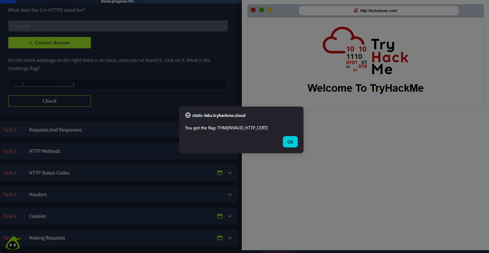

The mock webpage indicated a security issue with its HTTP connection. I clicked the lock or connection indicator beside the HTTP address to inspect the connection information. This revealed the challenge flag.

The exercise demonstrated why connection security matters. HTTP does not provide TLS encryption, whereas HTTPS protects data exchanged between the browser and server when TLS is correctly configured.

**Key Takeaway:** Always pay attention to whether a website uses HTTP or HTTPS, particularly when transmitting sensitive information.

---

## Task 2: Requests and Responses

HTTP communication follows a request-response model. A client sends a request to a server, and the server returns a response containing a status line, headers, and, when applicable, a response body.

### Example HTTP Response

```http
HTTP/1.1 200 OK

Server: nginx/1.15.8
Date: Fri, 09 Apr 2021 13:34:03 GMT
Content-Type: text/html
Content-Length: 98

<html>
<head>
    <title>TryHackMe</title>
</head>
<body>
    Welcome To TryHackMe.com
</body>
</html>
```

**Explanation of the Response:**

- `HTTP/1.1 200 OK`: Indicates the HTTP version and that the request was successful.
- `Server`: Identifies the web server software reported in the response.
- `Date`: Indicates when the response was generated.
- `Content-Type`: Specifies the media type of the response body.
- `Content-Length`: Specifies the size of the response body in bytes.
- **Response body:** Contains the HTML content returned by the server.

### Question 1: What HTTP protocol version is used in the example above?

**Answer:**

```text
HTTP/1.1
```

**Explanation:**

The HTTP version appears at the beginning of the status line. In this example, `HTTP/1.1` identifies the protocol version used for the response.

### Question 2: What response header tells the browser how much data to expect?

**Answer:**

```text
Content-Length
```

**Explanation:**

The `Content-Length` header specifies the size of the response body in bytes when that header is present. It helps the client determine how much response data to expect.

**Key Takeaway:** Understanding HTTP response headers makes it easier to inspect server behavior and troubleshoot web communication.

---

## Task 3: HTTP Methods

HTTP methods describe the action a client wants to perform on a resource. Different methods are commonly used for retrieving, creating, updating, and deleting resources.

### Question 1: What method would be used to create a new user account?

**Answer:**

```http
POST
```

**Explanation:**

`POST` is commonly used to submit data to a server for processing, such as creating a new user account or submitting a login form.

### Question 2: What method would be used to update your email address?

**Answer:**

```http
PUT
```

**Explanation:**

`PUT` is commonly used to create or replace the state of a resource at a specified URI. In this scenario, it represents updating a user's email address.

In real applications, `PATCH` is also frequently used when updating only selected fields of a resource.

### Question 3: What method would be used to remove a picture you have uploaded to your account?

**Answer:**

```http
DELETE
```

**Explanation:**

`DELETE` requests the removal of a specified resource. For example, an application might use it to delete an uploaded picture.

### Question 4: What method would be used to view a news article?

**Answer:**

```http
GET
```

**Explanation:**

`GET` is used to retrieve a resource from a server. When a user opens a news article, the browser commonly sends a GET request to retrieve the article's content.

**Key Takeaway:** HTTP methods communicate the intended action, but the actual behavior depends on how the web application implements and authorizes each request.

---

## Task 4: Status Codes

HTTP status codes indicate the result of a request. They are grouped into five categories:

- **1xx — Informational:** The request has been received and processing continues.
- **2xx — Success:** The request was successfully received or processed.
- **3xx — Redirection:** Further action is required, often to another URL.
- **4xx — Client errors:** The request cannot be fulfilled because of an issue with the request or the client's access.
- **5xx — Server errors:** The server failed to fulfill an apparently valid request.

### Question 1: What response code might you receive after creating a new user or blog post?

**Answer:**

```http
201 Created
```

**Explanation:**

The `201 Created` status code indicates that a request successfully created a resource, such as a new user account or blog post.

### Question 2: What response code might you receive when trying to access a page that does not exist?

**Answer:**

```http
404 Not Found
```

**Explanation:**

The `404 Not Found` status code indicates that the server cannot find the requested resource. For example, it may be returned when a user visits a URL that does not correspond to an existing page.

### Question 3: What response code might you receive if the web server cannot access its database and the application crashes?

**Answer:**

```http
503 Service Unavailable
```

**Explanation:**

The `503 Service Unavailable` status code indicates that the server is temporarily unable to handle the request. This can occur because of maintenance, overload, or temporary dependency failures.

A database failure can contribute to a 503 response, although the exact status code depends on how the application handles the error.

### Question 4: What response code might you receive if you try to edit your profile without logging in first?

**Answer:**

```http
401 Unauthorized
```

**Explanation:**

The `401 Unauthorized` status code indicates that valid authentication credentials are missing or insufficient for the requested operation.

A `403 Forbidden` response may be used when the client is authenticated but does not have permission to perform the action.

**Key Takeaway:** Status codes help identify whether a request succeeded, needs redirection, was rejected, or encountered a server-side problem.

---

## Task 5: Headers

HTTP headers carry additional information about requests and responses. They help clients and servers understand the content being exchanged and the context of the communication.

### Question 1: What header tells the web server which browser is being used?

**Answer:**

```http
User-Agent
```

**Explanation:**

The `User-Agent` request header identifies the client software making the request. It may include information about the browser, operating system, and rendering engine.

Servers can use this information to understand the requesting client, although the value can be modified or spoofed.

### Question 2: What header tells the browser what type of data is being returned?

**Answer:**

```http
Content-Type
```

**Explanation:**

The `Content-Type` response header identifies the media type of the response body.

For example:

```http
Content-Type: text/html
```

This indicates that the response body contains HTML content.

Other examples include `application/json` for JSON data and `image/png` for PNG images.

### Question 3: What header tells the web server which website is being requested?

**Answer:**

```http
Host
```

**Explanation:**

The `Host` request header identifies the hostname and, optionally, the port of the requested server.

For example:

```http
Host: example.com
```

A single web server can host multiple websites. The `Host` header helps it determine which website should handle the request.

**Key Takeaway:** Headers provide useful context about the client, requested website, and content exchanged between the client and server.

---

## Task 6: Cookies

Cookies allow websites to store small pieces of data in a browser. They are commonly used for session management, preferences, and other application-specific purposes.

### Question 1: Which header is used to set cookies in the browser?

**Answer:**

```http
Set-Cookie
```

**Explanation:**

The `Set-Cookie` response header instructs the browser to store a cookie.

For example:

```http
Set-Cookie: sessionid=abc123
```

When the browser makes subsequent requests to an applicable domain and path, it can send the stored cookie using the `Cookie` request header.

For example:

```http
Cookie: sessionid=abc123
```

Cookies can contain session identifiers that help a website recognize an authenticated user across multiple requests. Because session cookies can grant access to an account, they must be handled securely.

Security attributes such as `Secure`, `HttpOnly`, and `SameSite` can help protect cookies against certain attacks and misuse.

**Key Takeaway:** `Set-Cookie` is used by the server to set cookies, while `Cookie` is used by the browser to send applicable cookies back to the server.

---

## Task 7: Making Requests

In this task, I used TryHackMe's interactive request interface to send HTTP requests to different endpoints. I changed request methods, URI parameters, and body parameters, then examined the server responses to find the challenge flags.

These exercises demonstrated how the HTTP method and request data influence the behavior of a web application.

### Exercise 1: Make a GET Request to `/room`

**Request:**

```http
GET /room
```

**Screenshot:**

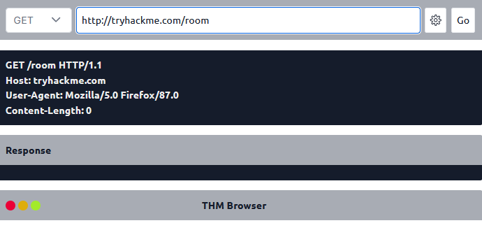

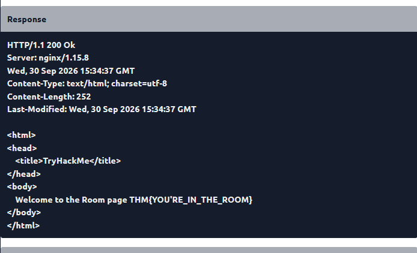

**How I Found the Answer:**

I selected the `GET` method, entered `/room` as the requested path, and sent the request using the interactive interface.

The server returned a response containing the challenge flag. This demonstrated how a GET request retrieves a resource from a specified endpoint.

**Flag:**

```text
THM{YOU'RE_IN_THE_ROOM}
```

### Exercise 2: Make a GET Request to `/blog` with the `id` Parameter Set to `1`

**Request:**

```http
GET /blog?id=1
```

**Screenshot:**

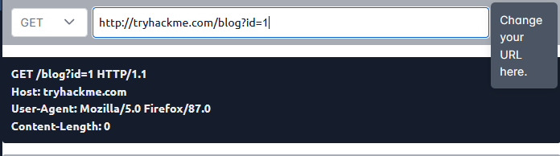

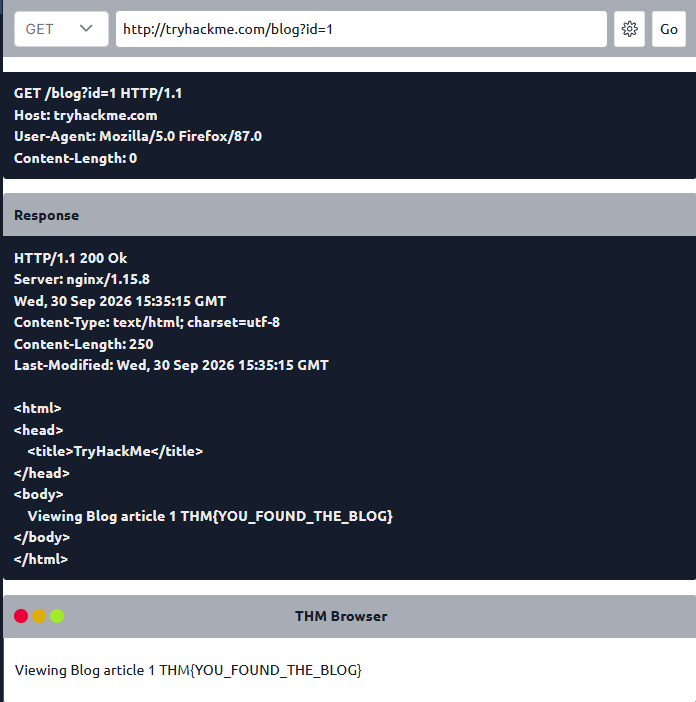

**How I Found the Answer:**

I selected the `GET` method and entered `/blog` as the endpoint. Using the gear button in the interface, I configured the URI parameter `id` with the value `1`.

After sending the request, the server returned a response containing the challenge flag.

This exercise demonstrated how query parameters pass additional information to an application. In this example, the `id` parameter identifies which blog resource the application should retrieve.

**Flag:**

```text
THM{YOU_FOUND_THE_BLOG}
```

### Exercise 3: Make a DELETE Request to `/user/1`

**Request:**

```http
DELETE /user/1
```

**Screenshot:**

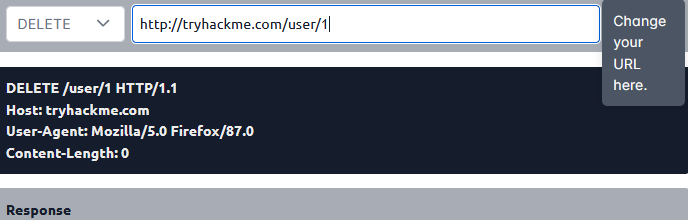

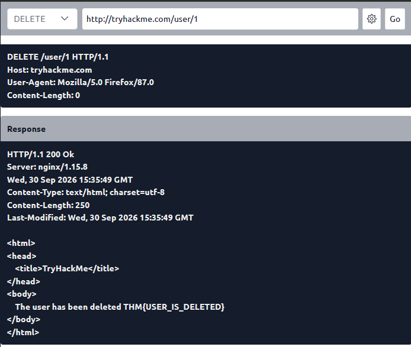

**How I Found the Answer:**

I selected the `DELETE` method, entered `/user/1` as the endpoint, and sent the request.

The server returned a response containing the challenge flag. The exercise demonstrated how a DELETE request can be used to request the removal of a specific resource, in this case, the user identified by `1`.

**Flag:**

```text
THM{USER_IS_DELETED}
```

### Exercise 4: Make a PUT Request to `/user/2` with the Username Set to `admin`

**Request:**

```http
PUT /user/2
```

**Body Parameter:**

```text
username=admin
```

**Screenshot:**

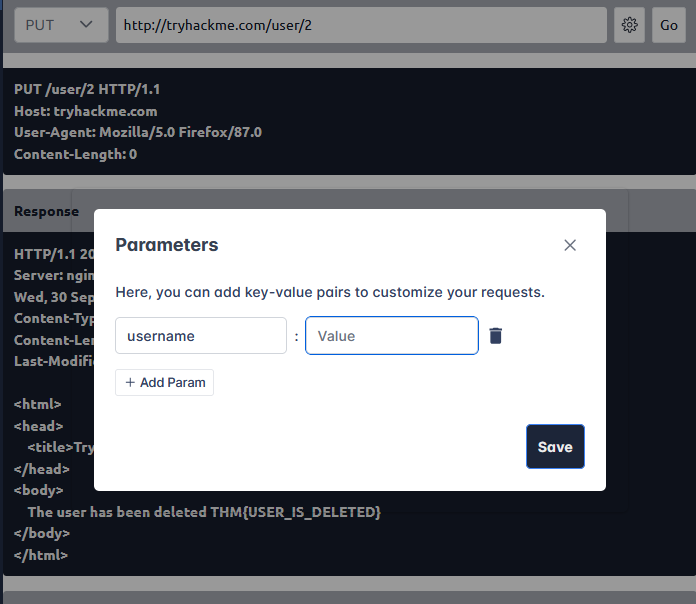

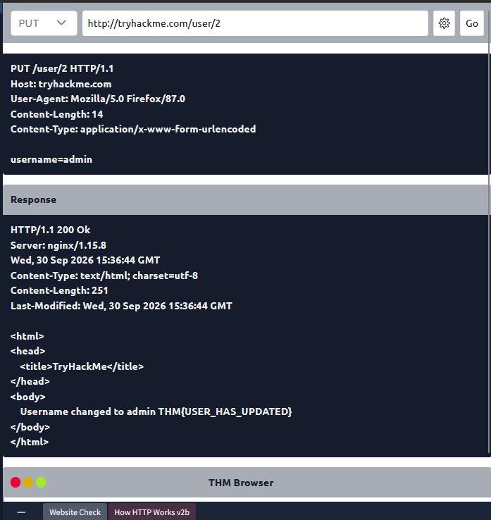

**How I Found the Answer:**

I selected the `PUT` method and entered `/user/2` as the endpoint. Using the gear button, I configured the body parameter `username` with the value `admin`.

After sending the request, the server returned a response containing the challenge flag.

This exercise demonstrated how a PUT request can submit data to update a resource. The request body carried the username value, while the endpoint identified the user being updated.

In a real application, changing a username or another sensitive field should require appropriate authentication and authorization checks.

**Flag:**

```text
THM{USER_HAS_UPDATED}
```

### Exercise 5: Make a POST Request to `/login` with the Username `thm` and Password `letmein`

**Request:**

```http
POST /login
```

**Body Parameters:**

```text
username=thm
password=letmein
```

**Screenshots:**

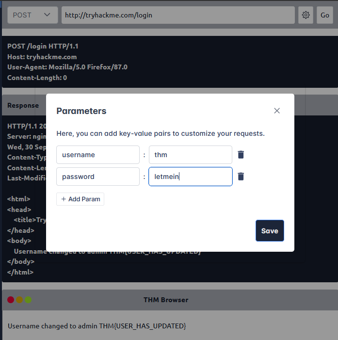

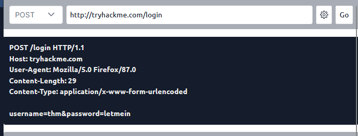

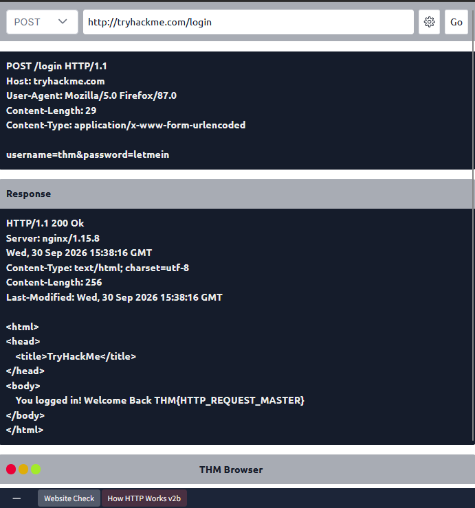

**How I Found the Answer:**

I selected the `POST` method and entered `/login` as the endpoint. Using the gear button, I configured the body parameters with the following credentials:

- Username: `thm`
- Password: `letmein`

I then sent the request and inspected the server's response, which contained the challenge flag.

This exercise demonstrated how login forms commonly submit credentials to a server using a POST request. The server processes the submitted information and returns an appropriate response.

POST does not automatically encrypt submitted data. HTTPS is necessary to protect credentials while they travel between the browser and server.

**Flag:**

```text
THM{HTTP_REQUEST_MASTER}
```

**Key Takeaway:** Sending requests manually helps build a practical understanding of HTTP methods, endpoints, parameters, request bodies, and server responses. These skills are also useful when inspecting web traffic with tools such as Burp Suite.

---

## What I Learned

After completing this room, I strengthened my understanding of the following concepts:

- **HTTP and HTTPS:** How web clients communicate with servers and why TLS-protected HTTPS is important.
- **Request-response model:** How HTTP requests and responses are structured.
- **HTTP methods:** The common uses of GET, POST, PUT, and DELETE.
- **Status codes:** How to interpret successful responses, client errors, and server errors.
- **HTTP headers:** How headers such as `Host`, `User-Agent`, `Content-Type`, and `Content-Length` provide information about requests and responses.
- **Cookies:** How `Set-Cookie` and `Cookie` headers support browser-side cookie storage and transmission.
- **URI parameters:** How query parameters such as `id=1` influence the resources requested from a server.
- **Request body parameters:** How data can be submitted through methods such as POST and PUT.
- **Practical HTTP testing:** How to send different requests, inspect responses, and identify information returned by the server.

These fundamentals are important for understanding web applications and progressing toward web application penetration testing.

## Conclusion

The *HTTP in Detail* room provided a practical introduction to the protocol that powers communication across the web. By experimenting with different HTTP methods, headers, status codes, cookies, and request parameters, I learned how clients interact with web servers and how servers respond to different operations.

This knowledge establishes a foundation for further study of web application security, HTTP traffic analysis, and penetration testing using tools such as Burp Suite.

## Room Status

| Platform | Room | Difficulty | Status |
|---|---|---|---|
| TryHackMe | HTTP in Detail | Beginner | ✅ Completed |

## Completion Screenshot


