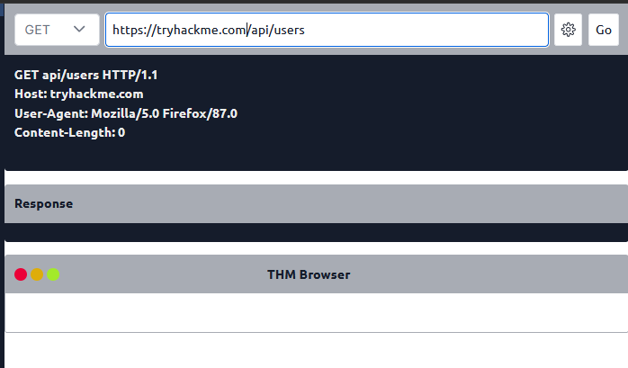
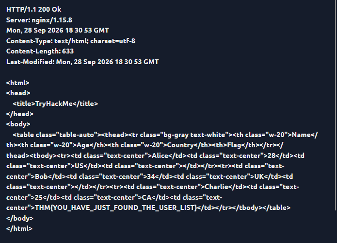
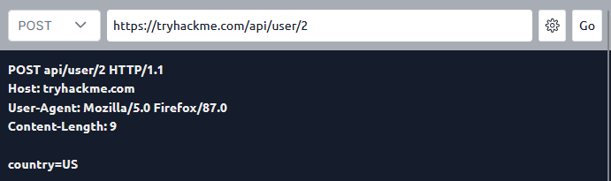
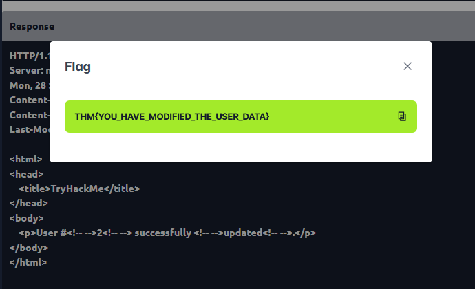
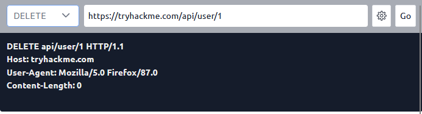
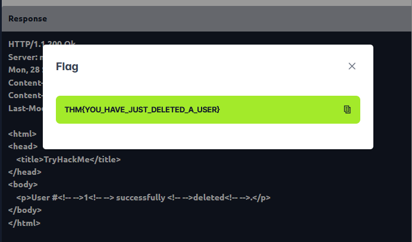

# Web Application Basics

**Platform:** TryHackMe  
**Room:** Web Application Basics  
**Difficulty:** Beginner  
**Status:** ✅ Completed

---

## Overview

This room introduced the fundamental concepts of web applications, including web servers, web browsers, URLs, HTTP messages, request methods, response codes, HTTP headers, and security headers.

The practical tasks provided hands-on experience with HTTP requests by retrieving user information, modifying user data, and deleting a user through API endpoints.

These concepts are essential for understanding how web applications communicate and form a foundation for learning web application penetration testing.

---

## Task 1: Introduction

### Overview

This task introduced the learning objectives of the room and prepared me to explore the fundamentals of web applications.

**Answer:** No answer needed.

---

## Task 2: Web Application Overview

### Question 1

Which component on a computer is responsible for hosting and delivering content for web applications?

**Answer:**
```text
Web server
```

**Explanation:**

A web server hosts web application resources and processes incoming HTTP requests from clients. It returns the requested content or forwards requests to the appropriate application logic.

Examples include Apache HTTP Server and Nginx.

### Question 2

Which tool is used to access and interact with web applications?

**Answer:**
```text
Web browser
```

**Explanation:**

A web browser allows users to access websites and interact with web applications. It sends HTTP or HTTPS requests to web servers and displays the returned content.

Examples include Google Chrome, Mozilla Firefox, and Microsoft Edge.

### Question 3

Which component acts as a protective layer, filtering incoming traffic to block malicious attacks and helping secure a web application?

**Answer:**
```text
Web Application Firewall (WAF)
```

**Explanation:**

A Web Application Firewall monitors and filters HTTP and HTTPS traffic between clients and a web application. It can detect and block suspicious requests associated with attacks such as SQL injection and cross-site scripting (XSS).

A WAF provides an additional security layer but does not replace secure application development or other security controls.

---

## Task 3: Uniform Resource Locator (URL)

### Question 1

Which protocol provides encrypted communication to ensure secure data transmission between a web browser and a web server?

**Answer:**
```text
HTTPS
```

**Explanation:**

HTTPS stands for Hypertext Transfer Protocol Secure. It uses TLS to encrypt communication between a client and a web server, helping protect transmitted data against interception and tampering.

For example, HTTPS helps protect login credentials and other sensitive information transmitted between a browser and a website.

### Question 2

What term describes the practice of registering domain names that are misspelled variations of popular websites to exploit user errors and potentially engage in fraudulent activities?

**Answer:**
```text
Typosquatting
```

**Explanation:**

Typosquatting involves registering domain names that resemble legitimate websites, often through common spelling mistakes or character substitutions.

Attackers may use these domains to distribute malware, steal credentials through phishing, or deceive visitors into interacting with fraudulent websites.

### Question 3

What part of a URL is used to pass additional information, such as search terms or form inputs, to the web server?

**Answer:**
```text
Query string
```

**Explanation:**

A query string contains parameters appended to a URL, typically after a question mark (`?`). Parameters are commonly represented as key-value pairs separated by ampersands (`&`).

Example:

```text
https://example.com/search?q=security&category=web
```

In this URL:

- `q=security` specifies the search term.
- `category=web` specifies the category.
- `&` separates the parameters.

Query strings are commonly used for searches, filters, and other application inputs. Sensitive information should not be placed in URLs because URLs may be recorded in browser history, server logs, and other locations.

---

## Task 4: HTTP Messages

### Question 1

Which HTTP message is returned by the web server after processing a client's request?

**Answer:**
```text
HTTP response
```

**Explanation:**

An HTTP response is the message sent by a server after receiving and processing an HTTP request.

It typically contains a status line, response headers, an empty line separating the headers from the body, and an optional response body.

The response communicates the result of the request and may contain HTML, JSON, images, or other data.

### Question 2

What follows the headers in an HTTP message?

**Answer:**
```text
Empty line
```

**Explanation:**

An empty line separates the header section from the message body in HTTP/1.x messages.

This separation allows the recipient to distinguish the metadata in the headers from the content in the body. The body, when present, may contain form data, HTML, JSON, or other content.

---

## Task 5: HTTP Requests, Request Lines, and Methods

### Question 1

Which HTTP protocol version became widely adopted and remains commonly used for web communication, introducing features such as persistent connections and chunked transfer encoding?

**Answer:**
```text
HTTP/1.1
```

**Explanation:**

HTTP/1.1 introduced important improvements over HTTP/1.0, including persistent connections by default and support for chunked transfer encoding.

Persistent connections allow multiple requests and responses to use the same TCP connection, reducing the overhead of establishing new connections.

HTTP/1.1 remains supported, although newer versions such as HTTP/2 and HTTP/3 are also widely used.

### Question 2

Which HTTP request method describes the communication options for the target resource, allowing clients to determine which HTTP methods are supported?

**Answer:**
```text
OPTIONS
```

**Explanation:**

The `OPTIONS` method asks a server about the communication options available for a resource.

A server may respond with an `Allow` header listing supported methods, such as `GET`, `POST`, and `DELETE`.

This method can help developers and security testers understand how a resource is intended to be accessed. Its response does not necessarily guarantee that every listed method will succeed for every request.

### Question 3

In an HTTP request, which component specifies the particular resource or endpoint on the web server that the client is requesting, typically appearing after the domain name in the URL?

**Answer:**
```text
URL path
```

**Explanation:**

The URL path identifies the requested resource or endpoint on a server.

For example:

```text
https://example.com/api/users
```

In this URL, `/api/users` is the path.

It identifies the API endpoint used to retrieve user-related information. In a typical HTTP/1.1 request, the path appears in the request line.

---

## Task 6: HTTP Requests — Headers and Body

### Question 1

Which HTTP request header specifies the domain name of the web server to which the request is being sent?

**Answer:**
```text
Host
```

**Explanation:**

The `Host` header identifies the target hostname and, optionally, its port number. It helps a server hosting multiple websites determine which website should handle the request.

Example:

```http
Host: example.com
```

This header is required in HTTP/1.1 requests.

### Question 2

What is the default content type for form submissions in an HTTP request when the data is encoded as key-value pairs?

**Answer:**
```text
application/x-www-form-urlencoded
```

**Explanation:**

The `application/x-www-form-urlencoded` media type is commonly used when submitting HTML form data as URL-encoded key-value pairs.

Example:

```http
Content-Type: application/x-www-form-urlencoded
```

A request body using this format might look like:

```text
username=bob&country=US
```

Special characters are encoded as necessary, and ampersands separate individual parameters.

### Question 3

Which part of an HTTP request contains additional information such as the host, user agent, and content type, guiding how the server should process the request?

**Answer:**
```text
Request headers
```

**Explanation:**

Request headers provide metadata about the client, the requested resource, and the request body.

Common examples include:

- `Host`: Identifies the target host.
- `User-Agent`: Describes the client software.
- `Content-Type`: Specifies the format of the request body.
- `Accept`: Indicates the response formats the client can accept.
- `Authorization`: May carry authentication credentials or tokens.

Understanding request headers is important during web application testing because they can influence authentication, content handling, and server behavior.

---

## Task 7: HTTP Responses — Status Lines and Status Codes

### Question 1

What part of an HTTP response provides the HTTP version, status code, and a brief explanation of the response's outcome?

**Answer:**
```text
Status line
```

**Explanation:**

The status line is the first line of an HTTP/1.x response. It contains the protocol version, a numeric status code, and a short reason phrase.

Example:

```http
HTTP/1.1 200 OK
```

Here:

- `HTTP/1.1` is the protocol version.
- `200` is the status code.
- `OK` is the reason phrase.

The status code indicates the general result of the request.

### Question 2

Which category of HTTP response codes indicates that the server encountered an internal issue or is unable to fulfill the request because of a server-side problem?

**Answer:**
```text
Server Error Responses
```

**Explanation:**

HTTP status codes in the `5xx` range indicate that the server failed to fulfill an apparently valid request.

Common examples include:

- `500 Internal Server Error`: An unexpected server-side error occurred.
- `502 Bad Gateway`: A gateway or proxy received an invalid response from an upstream server.
- `503 Service Unavailable`: The server is temporarily unable to handle the request.

These responses can help troubleshoot server-side issues.

### Question 3

Which HTTP status code indicates that the requested resource could not be found on the web server?

**Answer:**
```text
404
```

**Explanation:**

The `404 Not Found` status code indicates that the server cannot find the requested resource.

For example, requesting a nonexistent page or API endpoint may return:

```http
HTTP/1.1 404 Not Found
```

A `404` response does not necessarily mean that the entire website is unavailable; the problem may be limited to the requested resource.

---

## Task 8: HTTP Responses — Headers and Body

### Question 1

Which HTTP response header can reveal information about the web server's software and version, potentially exposing it to security risks if not removed?

**Answer:**
```text
Server
```

**Explanation:**

The `Server` response header may disclose information about the software handling a request.

Example:

```http
Server: nginx
```

Depending on the server configuration, this header may reveal additional implementation or version details. Such information can help attackers identify potentially vulnerable software.

Limiting unnecessary version disclosure reduces information leakage, although it does not replace patching and secure configuration.

### Question 2

Which flag should be added to cookies in the `Set-Cookie` response header to ensure they are transmitted only over HTTPS?

**Answer:**
```text
Secure
```

**Explanation:**

The `Secure` cookie attribute instructs browsers to send the cookie only over secure HTTPS connections, helping prevent exposure over unencrypted HTTP.

Example:

```http
Set-Cookie: session=abc123; Secure
```

This is particularly important for session cookies containing authentication-related information.

### Question 3

Which flag should be added to cookies in the `Set-Cookie` response header to prevent them from being accessed through JavaScript?

**Answer:**
```text
HttpOnly
```

**Explanation:**

The `HttpOnly` cookie attribute prevents client-side JavaScript from reading the cookie through interfaces such as `document.cookie`.

Example:

```http
Set-Cookie: session=abc123; HttpOnly
```

This helps reduce the risk of session-cookie theft through cross-site scripting (XSS). However, it does not prevent XSS itself or stop malicious scripts from performing other actions within the page.

---

## Task 9: Security Headers

### Question 1

In a Content Security Policy (CSP) configuration, which directive defines where scripts can be loaded from?

**Answer:**
```text
script-src
```

**Explanation:**

The `script-src` directive specifies permitted sources for JavaScript resources. It helps control which scripts a browser is allowed to load or execute.

Example:

```http
Content-Security-Policy: script-src 'self'
```

In this example, `'self'` permits scripts from the document's own origin, subject to the policy's other applicable rules.

A properly configured CSP can reduce the impact of certain cross-site scripting attacks by restricting unauthorized script execution.

### Question 2

Which directive should be included in the Strict-Transport-Security (HSTS) header to apply the HTTPS policy to all subdomains?

**Answer:**
```text
includeSubDomains
```

**Explanation:**

HTTP Strict Transport Security (HSTS) instructs browsers to access a website using HTTPS for the duration specified by the policy.

The `includeSubDomains` directive extends the policy to the domain's subdomains.

Example:

```http
Strict-Transport-Security: max-age=31536000; includeSubDomains
```

Here:

- `max-age=31536000` specifies a policy duration of one year in seconds.
- `includeSubDomains` applies the policy to subdomains as well.

This directive should only be enabled when all affected subdomains are properly configured to support HTTPS.

### Question 3

Which HTTP header directive prevents browsers from interpreting files as a different MIME type than the one specified by the server?

**Answer:**
```text
nosniff
```

**Explanation:**

The `X-Content-Type-Options` response header can use the `nosniff` directive to instruct browsers not to perform certain MIME-type sniffing behaviors.

Example:

```http
X-Content-Type-Options: nosniff
```

This helps prevent browsers from treating content as a different type than the one declared by the server, reducing risks associated with incorrectly interpreted content.

The directive is part of the broader effort to ensure that web content is served with appropriate content types.

---

## Task 10: Practical Task

This task provided hands-on practice with HTTP methods and API endpoints. I sent requests to retrieve user information, update a user's country, and delete a user.

The exercises demonstrated how HTTP methods interact with server-side resources and how an API communicates the outcome through its response.

### Practical 1: Retrieve the User List Using GET

**Question**

Make a `GET` request to `/api/users`. What is the flag?

**Answer:**
```text
THM{YOU_HAVE_JUST_FOUND_THE_USER_LIST}
```

**Explanation:**

I sent a `GET` request to the `/api/users` endpoint and examined the server's response. The response returned the user list and included the flag.

The `GET` method is generally used to retrieve a resource without requesting a change to the server's stored data.

This exercise demonstrated how API endpoints expose data through HTTP requests and how the response can be inspected to identify the returned information.

**Screenshots**





### Practical 2: Update a User's Country Using POST

**Question**

Make a `POST` request to `/api/user/2` and update Bob's country from UK to US. What is the flag?

**Answer:**
```text
THM{YOU_HAVE_MODIFIED_THE_USER_DATA}
```

**Explanation:**

I sent a `POST` request to the user endpoint for user ID `2` and updated Bob's country from `UK` to `US`. After sending the request, I examined the server's response and obtained the flag.

The `POST` method is commonly used to submit data to a server, create resources, or trigger application operations. In this exercise, the endpoint accepted the submitted data and performed the requested update.

The exact behavior of an HTTP method depends on the API implementation. In real-world testing, it is important to verify the response and confirm whether the intended change occurred.

**Screenshots**





### Practical 3: Delete a User Using DELETE

**Question**

Make a `DELETE` request to `/api/user/1` to delete the user. What is the flag?

**Answer:**
```text
THM{YOU_HAVE_JUST_DELETED_A_USER}
```

**Explanation:**

I sent a `DELETE` request to the `/api/user/1` endpoint to remove the user with ID `1`. After sending the request, I inspected the server's response and obtained the flag.

The `DELETE` method is intended to remove the specified resource. The exact result depends on the server's implementation and whether the request is authorized.

This exercise demonstrated how API endpoints use HTTP methods to perform actions on server-side resources.

**Screenshots**





---

## What I Learned

After completing this room, I strengthened my understanding of the following concepts:

- **Web application architecture:** The roles of web servers, browsers, and Web Application Firewalls.
- **URLs and protocols:** URL paths, query strings, HTTPS, and typosquatting.
- **HTTP message structure:** Request and response messages, headers, bodies, and the empty line separating headers from the body.
- **HTTP methods:** The purposes of `GET`, `POST`, `DELETE`, and `OPTIONS`.
- **HTTP headers:** How headers such as `Host`, `Content-Type`, and `Server` influence communication and reveal metadata.
- **HTTP status codes:** How response codes communicate successful requests, missing resources, and server-side errors.
- **Cookie security:** How the `Secure` and `HttpOnly` attributes help protect cookies.
- **Security headers:** How CSP, HSTS, and `X-Content-Type-Options: nosniff` improve browser-side security.
- **API testing:** How to send requests to API endpoints, inspect responses, and observe the effects of different HTTP methods.

These fundamentals provide a starting point for understanding web application vulnerabilities and performing authorized web security assessments.

---

## Conclusion

The **Web Application Basics** room provided a practical introduction to web application communication and security. By learning HTTP fundamentals, understanding common headers and status codes, and interacting with API endpoints, I developed a stronger foundation for further study in web application penetration testing.

This room is an important first step toward understanding how web applications work, how they can be secured, and how their behavior can be assessed during authorized security testing.

---

## Room Status

| Platform | Room | Difficulty | Status |
|---|---|---|---|
| TryHackMe | Web Application Basics | Beginner | ✅ Completed |

### Completion Screenshot


